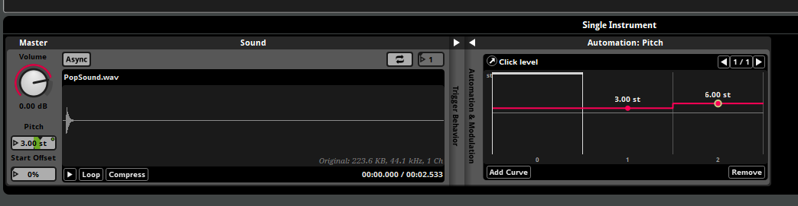

# FMOD sound event dev log

## Introduction (42 words)

The purpose of this project was to understand how audio middleware can be integrated into Unity to create sound events. I decided to use FMOD studio to develop a system where a click sound is played when a square has been pressed. 

## How Was FMOD Integrated into Unity? (186 words)

I chose to use FMOD as it integrates with Unity and allows me to create sound events separate to the game code. This allows me to change how the audio behaves inside FMOD without having to rewrite the code which triggers it i.e adding parameters rather than using seperate audio files for each variation. 

To integrate FMOD into Unity, I installed FMOD studio alongisde its Unity integration package. I then created an FMOD studio project and linked it to Unity through the set up wizard. This then allowed the events that I created in FMOD to be accessed and triggered in Unity. 

I replaced Unity's audio listener with FMOD's studio listener so FMOD could use the cameras position and orientation when calculating how 3D sounds should be heard if I were to implement these later down the line. 

After creating my audio event, I assigned it to the Master Bank and built the sound banks in FMOD Studio. This generated the files Unity needed to access and play the sound. I then checked Unity's FMOD Events Browser to confirm that the CubeClick event had been recognised.

## What Events Were Triggered and Logged? (189 words)

I created a 2D audio event in FMOD studio called `CubeClick`, which used a short popping sound. To trigger the event, I attached a C# script to a cube inside of Unity. I used `OnMouseDown()` to detect when the player has interacted with the cube which then triggers the sound event in FMOD.

To expand on this task, I decided to research into parameters inside of FMOD to make the popping sound increase in pitch each time it is clicked over the course of 3 clicks. After the third click, the parameter is returned back to its normal value. Using a parameter allowed me to control multiple pitch variations through one FMOD event rather than creating separate events for each sound. This also demonstrated how audio can respond dynamically to player interactions which could be useful in a larger game project.


**Figure 1** `Click level` parameter inside of FMOD.

I used `RuntimeManager.CreateInstance()` to create the audio event and `setParameterByName()` to change the pitch before playing the sound.

I also used `Debug.Log()` to record when the event was triggered and which pitch parameter value was selected. This helped me check that the parameter was cycling correctly.

```C# 
private void OnMouseDown()
{
    EventInstance sound =
        RuntimeManager.CreateInstance(cubeClickEvent);

    sound.setParameterByName("Click level", clickLevel);

    sound.start();
    sound.release();

    Debug.Log(
        $"FMOD CubeClick triggered - Click Level: {clickLevel}"
    );

    clickLevel = (clickLevel + 1) % 3;
}
```

## How Was the Middleware Validated in a Packaged Build? (84 words)

To validate the FMOD integration, I tested the audio event inside the Unity editor to ensure that clicking the cube triggered the popping sound to play. Once it was working, I created a windows build and tested it inside of there. I clicked the cube over a few times to make sure I heard all of the pitch changes and it going back to normal afterwards. This was necessary as it confirmed that FMOD and its sound banks were working correctly outside of Unity.

[YouTube link](https://youtu.be/EhKU6n_iHrY)

*Video demonstration of final result.*

## Declaration and sources 

FMOD - Integration Tutorial (s.d.) At: https://www.fmod.com/docs/2.04/unity/integration-tutorial.html (Accessed  18/11/2026).

Playing FMOD Events in Unity (s.d.) At: https://alessandrofama.com/tutorials/fmod/unity/events (Accessed  18/11/2026).

FMOD - Parameters (s.d.) At: https://www.fmod.com/docs/2.03/studio/parameters.html (Accessed  18/11/2026).

FMOD 2.0 & Unity | How To Implement Parameters (2019) Directed by Henry Scott. At: https://www.youtube.com/watch?v=QujIch7TPBU (Accessed  18/11/2026).

Click Sound Music | No Copyright Song & MP3 Free Downloads - Pixabay (s.d.) At: https://pixabay.com/music/search/click%20sound/ (Accessed  18/11/2026). - sound effect used 